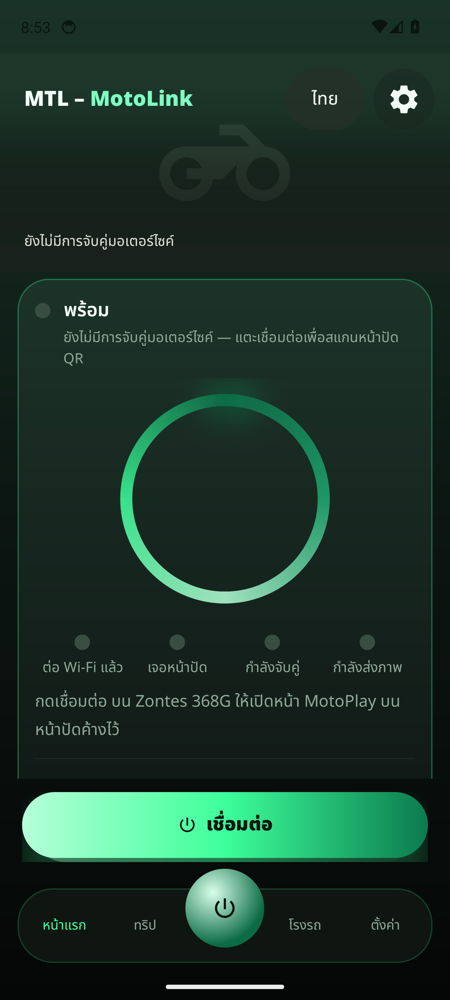
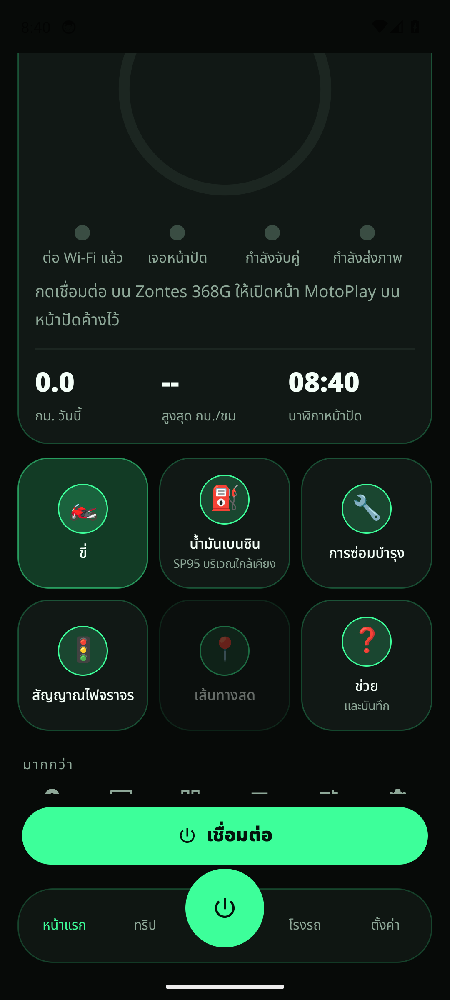
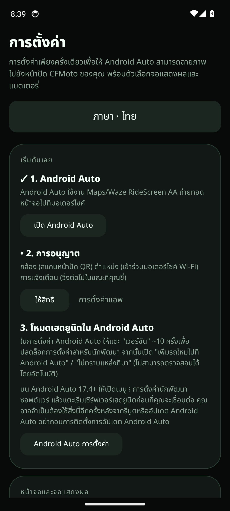
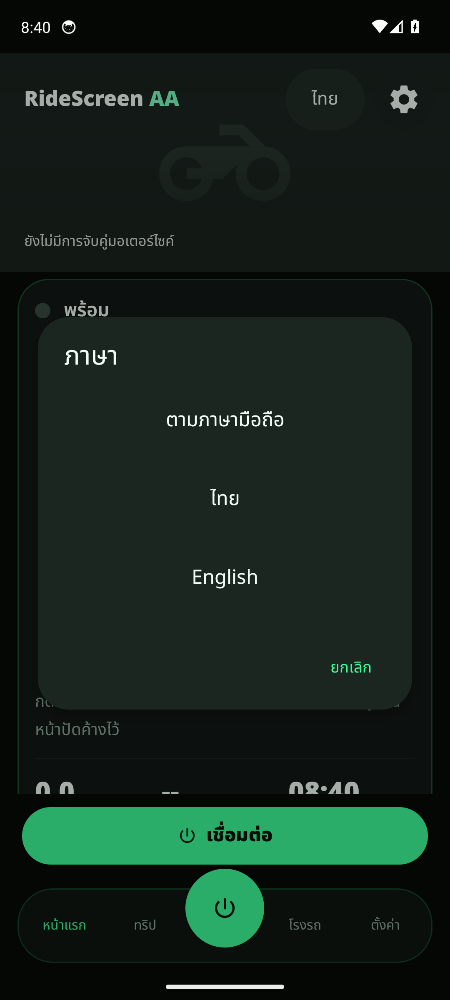

# MTL – MotoLink

**MTL – MotoLink** ส่งหน้าจอแบบ Android Auto ไปที่หน้าปัดรถมอเตอร์ไซค์ผ่าน Wi-Fi ไม่ต้องรูทเครื่อง ชื่อบนหน้าจอเครื่องคือ **MTL** ทดลองใช้กับ **Zontes 368G V2** และมือถือ **Samsung Galaxy S23 Ultra**

โปรเจกต์นี้เป็นฟอร์กของ [mgb1982/ridescreen-aa](https://github.com/mgb1982/ridescreen-aa) ซึ่งต่อจาก [OpenCfMoto](https://github.com/zanderp/open-cfmoto) ของ Alexandru (zanderp) **ไม่ใช่แอปทางการของ Zontes, CFMoto หรือ Google**

ภาษาในแอปตามภาษามือถือ และมีตัวเลือกในแอปเป็น **ไทย / English / ตามระบบ**

<p align="center">




</p>

## ทำอะไรได้

- ส่ง **Android Auto** (แผนที่ เพลง ผู้ช่วย) ไปที่หน้าปัด EasyConn / Carbit / MotoPlay แบบไร้สาย
- แสดงขั้นตอนเชื่อมต่อชัดเจน: **ต่อ Wi-Fi แล้ว → เจอหน้าปัด → กำลังจับคู่ → กำลังส่งภาพ**
- ถ้าเชื่อมไม่สำเร็จ แอปบอกขั้นถัดไป เช่น ดับสวิตช์แล้วเปิดใหม่ แล้วเปิดหน้า MotoPlay ค้างไว้
- ปรับภาษาไทยหรืออังกฤษในแอป ตัวอักษรไทยใช้ Noto Sans Thai
- ปุ่มใหญ่จับถนัดแม้ใส่ถุงมือ ธีมมืดโทนเขียวมินต์
- บันทึกทริป จุดจอดรถ บำรุงรักษา และแอป Wear OS ตามของต้นทาง

พฤติกรรมการคุยกับหน้าปัด (โปรโตคอล) ไม่ได้ถูกเปลี่ยนจากต้นทาง

## ดาวน์โหลดและติดตั้ง

1. เปิด [Releases](https://github.com/natthapongnks/ridescreen-aa/releases) แล้วดาวน์โหลด APK รุ่นพรีวิว (prerelease)
2. ถ้าระบบขึ้น Play Protect เพราะแอปยังไม่อยู่บน Play Store ให้เลือก **รายละเอียดเพิ่มเติม → ติดตั้งต่อไป**
3. เปิดแอป แล้วเลือกภาษาได้ที่ปุ่ม **ไทย** บนหน้าแรก หรือในการตั้งค่า

## วิธีเชื่อมต่อ

1. บน Zontes 368G V2 เปิดหน้า **MotoPlay** (หน้าจอที่มี QR) ค้างไว้
2. ในแอป กด **เชื่อมต่อ** แล้วสแกน QR หรือใช้รถที่จำไว้แล้ว
3. ให้มือถือเข้า **Wi-Fi ของรถ** เมื่อระบบถาม ให้กดเชื่อมต่อและอย่าปิดหน้าต่างนั้นค้าง
4. ในแอป Android Auto เปิดเมนู ⋮ แล้ว **Start head unit server** (ครั้งแรกอาจต้องแตะ Version ประมาณ 10 ครั้งเพื่อปลดล็อกเมนูนักพัฒนา) จากนั้นกดเชื่อมต่ออีกครั้ง
5. เมื่อวงสถานะครบและขึ้นว่ากำลังส่งภาพ เก็บมือถือได้

บน Samsung ให้ปิดการจำกัดแบตเตอรี่ของแอปนี้ และเปิด Wi-Fi กับอุปกรณ์ใกล้เคียงไว้

## ถ้าเชื่อมค้างที่ «กำลังจับคู่»

1. ดับสวิตช์กุญแจ รอประมาณ 5 วินาที แล้วเปิดใหม่
2. เปิดหน้า MotoPlay บนหน้าปัดค้างไว้
3. กด **เชื่อมต่อ** อีกครั้ง
4. ถ้า Android Auto ไม่เริ่ม ให้รีสตาร์ท head unit server แล้วลองใหม่
5. ถ้ายังไม่ได้ ไปที่ความช่วยเหลือแล้วแชร์บันทึก

## บิลด์จากซอร์ส

ต้องมี Android SDK (compileSdk 36.1) และ JDK 17 ขึ้นไป

```bash
./gradlew :app:assembleGithubDebug
```

APK อยู่ที่ `app/build/outputs/apk/github/debug/app-github-debug.apk`

## เครดิต

- [mgb1982/ridescreen-aa](https://github.com/mgb1982/ridescreen-aa) — RideScreen AA ต้นทาง (Manel)
- [OpenCfMoto](https://github.com/zanderp/open-cfmoto) — Alexandru (zanderp) และผู้ร่วมพัฒนา open-cfmoto
- ฟอนต์ไทย: Noto Sans Thai (SIL OFL 1.1) ดู `licenses/OFL-NotoSansThai.txt`
- ฟอนต์ละติน: Archivo (SIL OFL 1.1)

## สัญญาอนุญาต

[AGPL-3.0-or-later](LICENSE) ดู [NOTICE](NOTICE) ด้วย

ไม่เกี่ยวข้องกับ Zontes, CFMoto หรือ Google Android Auto เป็นเครื่องหมายการค้าของ Google LLC

---

## English

**MTL – MotoLink** (launcher name **MTL**) mirrors an Android Auto-style screen from an Android phone onto a motorcycle dash over Wi-Fi. This fork is aimed at a **Zontes 368G V2** with a **Samsung Galaxy S23 Ultra**. It is a fork of [mgb1982/ridescreen-aa](https://github.com/mgb1982/ridescreen-aa), itself built on [OpenCfMoto](https://github.com/zanderp/open-cfmoto) by Alexandru (zanderp). It is not an official Zontes, CFMoto, or Google app.

The phone language is used by default. An in-app picker can force **ไทย**, **English**, or follow the system. Thai text uses Noto Sans Thai.

### Features

- Wireless projection to EasyConn / Carbit / MotoPlay dashes
- Four-step connection status: Wi-Fi joined, dashboard found, linking, streaming
- Next-step errors (restart the ignition, leave MotoPlay open, start the Android Auto head unit server)
- Large glove-friendly controls and a dark mint smart-home look
- Trip log, parking spot, maintenance, and the Wear OS app from upstream
- Dash protocol behaviour is unchanged

### Download

Install the prerelease APK from [GitHub Releases](https://github.com/natthapongnks/ridescreen-aa/releases). If Play Protect warns you, choose More details, then Install anyway.

### Setup

1. On the Zontes 368G, leave the **MotoPlay** QR screen open.
2. In the app, tap **Connect** and scan the dash QR (later rides can reuse the saved bike).
3. Join the **bike Wi-Fi** when the phone asks. Do not leave that dialog sitting open.
4. In Android Auto, open the ⋮ menu and **Start head unit server** (the first time, tap Version about 10 times to unlock developer settings), then tap Connect again.
5. When the ring completes and the status says the picture is streaming, the phone can go in a pocket.

On a Samsung phone, turn off battery limits for this app and leave Wi-Fi and Nearby devices allowed.

### If it stays on “Linking”

Turn the ignition off, wait about 5 seconds, turn it on, open MotoPlay, and tap Connect again. If Android Auto never starts, restart its head unit server. If it still fails, share the logs from Help.

### Build

JDK 17+ and Android SDK 36.1.

```bash
./gradlew :app:assembleGithubDebug
```

### Credits and license

Upstream: [mgb1982/ridescreen-aa](https://github.com/mgb1982/ridescreen-aa) and [OpenCfMoto](https://github.com/zanderp/open-cfmoto). License: [AGPL-3.0-or-later](LICENSE). See [NOTICE](NOTICE). Android Auto is a trademark of Google LLC.
